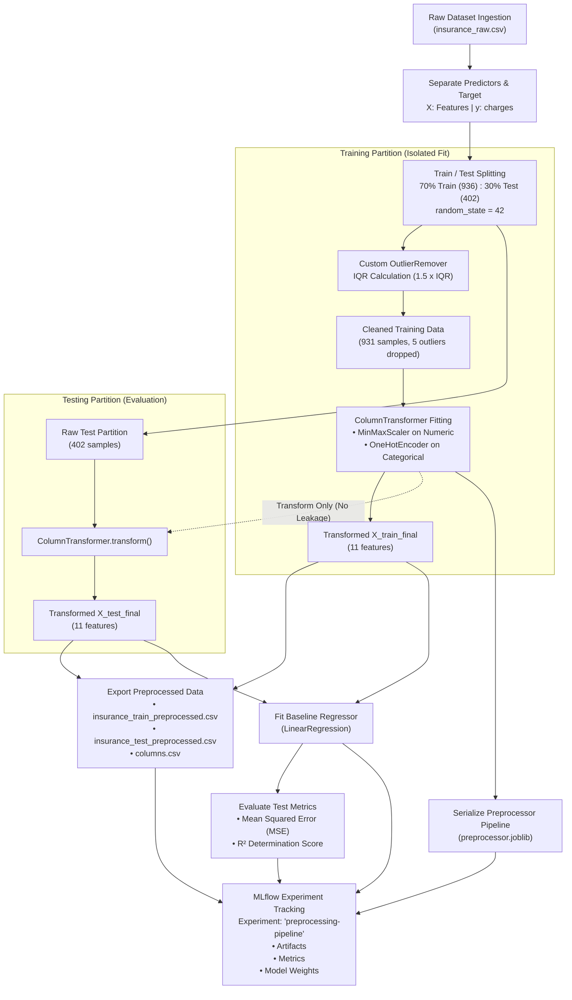

<div align="center">

# 🏥 Medical Insurance Cost Prediction
### End-to-End Automated Preprocessing & Baseline MLOps Pipeline

<p align="center">
  <em>✨ Crafting reproducible data pipelines, leakage-free transformations, and robust MLOps workflows. ✨</em>
</p>

<p align="center">
  <a href="https://github.com/jihanbuildspace/eksperimen_SML-2025"></a>
  <a href="https://github.com/jihanbuildspace/eksperimen_SML-2025/actions/workflows/preprocessing.yml"></a>
</p>

<p align="center">
  <b>A reproducible, production-grade Machine Learning pipeline designed for healthcare insurance risk prediction.</b><br>
  Featuring automated data leakage-free preprocessing, IQR outlier clipping, Scikit-Learn pipeline serialization, MLflow experiment tracking, and continuous integration via GitHub Actions.
</p>

[Quick Start](#-quick-start-guide) • [Architecture](#️-pipeline-architecture--workflow) • [Tech Stack](#️-tech-stack--tools) • [MLflow Results](#-mlflow-experiment-tracking--baseline-results) • [CI/CD](#-cicd-automation-github-actions)

</div>

---

## 🛠️ Tech Stack & Tools

<p align="center">
  
  
  
  
  
</p>

<p align="center">
  
  
  
  
  
  
</p>

---

## 📌 Table of Contents
- [📖 Project Overview](#-project-overview)
- [✨ Core Capabilities](#-core-capabilities)
- [🛠️ Tech Stack & Tools](#️-tech-stack--tools)
- [📊 Dataset & Feature Engineering](#-dataset--feature-engineering)
- [🏗️ Pipeline Architecture & Workflow](#️-pipeline-architecture--workflow)
- [🗂️ Repository Structure](#️-repository-structure)
- [🚀 Quick Start Guide](#-quick-start-guide)
- [📈 MLflow Experiment Tracking & Baseline Results](#-mlflow-experiment-tracking--baseline-results)
- [🤖 CI/CD Automation (GitHub Actions)](#-cicd-automation-github-actions)
- [📦 Pipeline Output Artifacts](#-pipeline-output-artifacts)
- [👩‍💻 Author & Acknowledgments](#-author--acknowledgments)
- [📄 License](#-license)

---

## 📖 Project Overview

Predicting individual healthcare expenditure (**medical insurance charges**) is a fundamental requirement in actuarial analysis, insurance premium pricing, and healthcare risk management. Raw healthcare datasets often exhibit significant skewness, multi-scale numerical distributions, and demographic categorical factors that must be systematically prepared before feeding into regression models.

This project delivers an automated, verifiable, and reproducible **Data Preprocessing and Baseline Modeling Pipeline** built under MLOps principles for the **Machine Learning Systems (MSML) 2025** program.

### Primary Goals:
1. **Zero Data Leakage:** Ensure training and testing distributions are strictly isolated during scaling and statistical outlier detection.
2. **Modular Transformation:** Employ `scikit-learn`'s `ColumnTransformer` and custom transformers for reusable and scalable preprocessing.
3. **Reproducibility & Serialization:** Export the fitted preprocessing pipeline (`preprocessor.joblib`) so new, unseen inference samples can be transformed instantaneously.
4. **Experiment Traceability:** Centrally track preprocessing parameters, dataset splits, regression models, and evaluation metrics using **MLflow**.
5. **Continuous Integration:** Automatically execute, test, and archive preprocessing artifacts on every commit via **GitHub Actions**.

---

## ✨ Core Capabilities

- ⚡ **Automated Preprocessing Orchestration:** End-to-end execution with a single command (`python run_preprocessing.py`).
- 🛡️ **Leakage-Safe Outlier Handling:** Custom IQR (`OutlierRemover`) transformer calculated strictly on the training partition ($Q_1 - 1.5 \times IQR$ to $Q_3 + 1.5 \times IQR$).
- 📏 **Numerical Feature Scaling:** Applies `MinMaxScaler` across numerical columns (`age`, `bmi`, `children`) to standardize scales within $[0, 1]$.
- 🏷️ **Categorical Vectorization:** Leverages `OneHotEncoder` on demographic attributes (`sex`, `smoker`, `region`).
- 💾 **Pipeline Persistence:** Persists the complete `ColumnTransformer` state into `preprocessor.joblib`.
- 📊 **Baseline Regression:** Automatically trains a benchmark `LinearRegression` model to validate data quality and establish a performance baseline.
- 🔬 **MLflow Experiment Versioning:** Direct metric logging ($R^2$, $MSE$) and artifact serialization into the `preprocessing-pipeline` experiment registry.
- 🤖 **Automated CI/CD:** Headless execution and multi-artifact uploading in GitHub Actions with 90-day persistence.

---

## 📊 Dataset & Feature Engineering

The dataset is sourced from the [Kaggle Medical Cost Personal Datasets](https://www.kaggle.com/datasets/mirichoi0218/insurance) and is pre-packaged within this repository as [`insurance_raw.csv`](insurance_raw.csv) (1,338 rows).

### Data Dictionary & Transformation Strategy

| Feature Name | Type | Description | Preprocessing Transformation | Dimension Output |
| :--- | :---: | :--- | :--- | :---: |
| **`age`** | `int64` | Primary beneficiary age (18 - 64) | `MinMaxScaler` | 1 |
| **`sex`** | `object` | Gender (`female`, `male`) | `OneHotEncoder` | 2 |
| **`bmi`** | `float64` | Body Mass Index (15.96 - 53.13) | IQR Outlier Filter + `MinMaxScaler` | 1 |
| **`children`** | `int64` | Number of insured dependent children (0 - 5) | `MinMaxScaler` | 1 |
| **`smoker`** | `object` | Smoking status (`yes`, `no`) | `OneHotEncoder` | 2 |
| **`region`** | `object` | US residential zone (`northeast`, `northwest`, `southeast`, `southwest`) | `OneHotEncoder` | 4 |
| **`charges`** *(Target)* | `float64` | Annual medical expenditure billed by insurance | Continuous Target Variable | 1 |

> [!NOTE]
> **Dimensionality:** Raw input consists of 6 predictors. Following one-hot encoding and min-max scaling, the pipeline yields **11 transformed feature dimensions** + 1 continuous target column.

---

## 🏗️ Pipeline Architecture & Workflow



---

## 🗂️ Repository Structure

```text
eksperimen_SML-2025/
├── .github/
│   └── workflows/
│       └── preprocessing.yml               # Automated CI workflow configuration
├── mlruns/                                 # MLflow local tracking experiment repository
│   └── 810507816068581157/                 # Preprocessing pipeline run metadata & metrics
├── preprocessing/
│   ├── insurance_preprocessing/
│   │   ├── columns.csv                     # Processed feature headers reference
│   │   ├── insurance_train_preprocessed.csv# Final preprocessed training split (931 rows)
│   │   └── insurance_test_preprocessed.csv # Final preprocessed testing split (402 rows)
│   ├── automate_jkw.py                     # Pipeline module, IQR transformer, & MLflow logger
│   ├── preprocessor.joblib                 # Serialized Scikit-Learn ColumnTransformer
│   └── Eksperimen_MSML_Jihan_Kusumawardhani.ipynb # Jupyter notebook (EDA & Prototyping)
├── .gitignore                              # Git exclusion rules
├── insurance_raw.csv                       # Medical insurance raw dataset
├── requirements.txt                        # Project Python dependencies
├── run_preprocessing.py                    # Pipeline orchestrator script
└── README.md                               # Project documentation
```

---

## 🚀 Quick Start Guide

### 1. Clone the Repository
```bash
git clone https://github.com/jihanbuildspace/eksperimen_SML-2025.git
cd eksperimen_SML-2025
```

### 2. Set Up a Virtual Environment

**Windows (PowerShell):**
```powershell
python -m venv venv
.\venv\Scripts\Activate.ps1
```

**Linux / macOS:**
```bash
python3 -m venv venv
source venv/bin/activate
```

### 3. Install Required Dependencies
```bash
pip install --upgrade pip
pip install -r requirements.txt
```

### 4. Execute the Preprocessing Pipeline
Execute the complete workflow (cleaning, outlier detection, scaling, baseline modeling, and MLflow logging) in a single run:
```bash
python run_preprocessing.py
```

### 5. Launch the MLflow UI Dashboard
To visually review your experiment parameters, metrics history, and artifacts:
```bash
mlflow ui
```
Navigate to **`http://127.0.0.1:5000`** in your browser.

---

## 📈 MLflow Experiment Tracking & Baseline Results

All pipeline runs are logged under the **`preprocessing-pipeline`** experiment in MLflow. The baseline model is trained using a benchmark `LinearRegression` regressor.

### Empirical Evaluation Metrics

| Metric | MLflow Identifier | Measured Value | Analysis & Meaning |
| :--- | :---: | :---: | :--- |
| **Mean Squared Error** | `mse` | **`33,977,041.23`** | Average squared prediction error ($RMSE \approx \$5,828.98$) |
| **R² Score** | `r2` | **`0.7683`** | The baseline model explains **~76.83%** of target variance |

### Tracked Artifacts in MLflow
- 📦 `preprocessor.joblib`: Serialized inference-ready preprocessing pipeline.
- 📋 `columns.csv`: Reference mapping of raw feature names.
- 📊 `insurance_train_preprocessed.csv` & `insurance_test_preprocessed.csv`: Clean, normalized datasets.
- 🧠 `model/`: Packaged Scikit-Learn model including conda environment and `MLmodel` specification.

---

## 🤖 CI/CD Automation (GitHub Actions)

This project features an automated Continuous Integration pipeline defined in [`.github/workflows/preprocessing.yml`](.github/workflows/preprocessing.yml).

```mermaid
graph LR
    Push[Push to main / Dispatch] --> Runner[Ubuntu 22.04 + Python 3.10]
    Runner --> Install[Install Dependencies via requirements.txt]
    Install --> Exec[Run Pipeline via run_preprocessing.py]
    Exec --> Verify[Verify Data Integrity & Output Files]
    Verify --> Upload[Upload GitHub Build Artifacts (90-day retention)]
```

### Key Workflow Features:
- **Triggers:** Automatically runs on every `push` to the `main` branch, or via manual `workflow_dispatch`.
- **Environment:** Containerized execution on `ubuntu-latest` with Python `3.10`.
- **Artifact Publishing:** Automatically packages and uploads the preprocessed CSV datasets and `.joblib` pipeline into GitHub Artifacts for downstream service integration.

---

## 📦 Pipeline Output Artifacts

| Output File | Target Path | Description |
| :--- | :--- | :--- |
| `preprocessor.joblib` | `preprocessing/` | Serialized transformer for production inference pipeline |
| `columns.csv` | `preprocessing/insurance_preprocessing/` | Feature header reference for input verification |
| `insurance_train_preprocessed.csv` | `preprocessing/insurance_preprocessing/` | Cleaned and normalized training set (931 rows) |
| `insurance_test_preprocessed.csv` | `preprocessing/insurance_preprocessing/` | Transformed test set for unbiased validation (402 rows) |
| `model/` | `mlruns/` | Scikit-Learn baseline linear model logged in MLflow |

---

## 👩‍💻 Author & Acknowledgments

<div align="center">

**Jihan Kusumawardhani**  
[](https://github.com/jihanbuildspace)

*Building Machine Learning Systems (MSML 2025)*

</div>

- **Dataset Credit:** [Miri Choi](https://www.kaggle.com/datasets/mirichoi0218/insurance) via Kaggle.
- **Reference Framework:** Scikit-Learn Preprocessing & MLflow Tracking Architecture.

---

## 📄 License

This project is licensed under the [MIT License](LICENSE). You are free to use, modify, and distribute this codebase for educational, research, and production workflows.